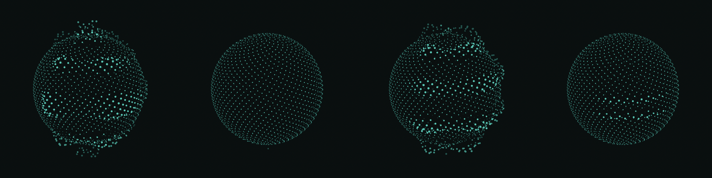

# @thecharlesponti/waveform-react

[](https://github.com/charlesponti/waveform-react/actions/workflows/ci.yml)
[](https://www.npmjs.com/package/@thecharlesponti/waveform-react)

[](LICENSE)

A sphere of dots that listens, as React components, with the interactive explainer of the maths behind it.



Time runs from the equator to the poles, pitch runs round the sphere, and loudness pushes each dot out.
[Live demo and explainer](https://charlesponti.github.io/voice-orb/) · Swift version:
[waveform-ios](https://github.com/charlesponti/waveform-ios).

## Install

```bash
npm i @thecharlesponti/waveform-react
```

React 18 or newer. ESM only, with types.

## Quick start

```tsx
import { VoiceOrb } from '@thecharlesponti/waveform-react';

export default () => <VoiceOrb signal="vowels" style={{ width: 360 }} />;
```

The orb reads precomputed analysis of looping sounds. It does not listen to a live microphone yet (see
[Not yet](#not-yet)).

## Components

| Component | What it is |
| --- | --- |
| `<VoiceOrb />` | The orb |
| `<SpectrumMap />` | The same data laid flat: pitch across, time up |
| `<SignalPicker />` | Chips to choose the sound, plus Sound and Pause buttons |
| `<OrbExplainer />` | The whole interactive article. Import `@thecharlesponti/waveform-react/style.css` once |

### `<VoiceOrb />` props

| Prop | Default | |
| --- | --- | --- |
| `signal` | the transport's | `'vowels' \| 'hum' \| 'whistle' \| 'arpeggio' \| 'hiss' \| 'drums'`, or an `Analysis` from `analyse()` |
| `mode` | `'spectrum'` | `'spectrum'` (pitch and time) or `'loudness'` (time only) |
| `dots` | `1800` | Number of dots |
| `gain` | `0.5` | How far full-scale sound pushes a dot out, as a fraction of the radius |
| `history` | `0.8` | Seconds of sound the sphere spans |
| `wrap` | `1` | `0` is a flat map, `1` the sphere; animate it to unwrap |
| `spin` | `0.12` | Radians a second; `0` holds still |
| `colorBy` | `null` | `'age'` or `'pitch'` colours dots one by one |
| `transport` | shared | A `Transport` to keep a group of orbs on their own clock |

`<SpectrumMap />` takes `signal`, `history` and `transport`.

## One clock

Every orb reads time from a `Transport`. With sound off it is the page clock. `transport.setSound(true)` (call it
from a click) plays the signal and switches every picture to the audio clock minus the output latency, so what you
see matches what you hear.

```tsx
import { SignalPicker, Transport, VoiceOrb } from '@thecharlesponti/waveform-react';

const stage = new Transport();

<>
  <SignalPicker transport={stage} />
  <VoiceOrb transport={stage} />
</>
```

## Your own sound

```tsx
import { analyse, VoiceOrb } from '@thecharlesponti/waveform-react';

const analysis = useMemo(() => analyse(samples /* Float32Array, mono, 16 kHz */), [samples]);
<VoiceOrb signal={analysis} />
```

`analyse` takes about 60 ms for eight seconds of audio, and the orb loops what it is given.

## The explainer

```tsx
import { OrbExplainer } from '@thecharlesponti/waveform-react';
import '@thecharlesponti/waveform-react/style.css';

export default () => <OrbExplainer />;
```

Its CSS is scoped under `.rvo`, so it cannot leak into your page. It uses IBM Plex Sans, IBM Plex Mono and
Instrument Serif if you load them, and falls back to system fonts otherwise; override `--display`, `--body` and
`--mono` on `.rvo` to change them.

## Maths

`columns`, `analyseFrame` and `bandsFor` are exported and tested. A sine of amplitude A reads A/√2 in its band, the
band powers add up to the signal's mean square, and column edges are `round(k · sampleRate / rate)`.

## Not yet

- A live microphone input. It needs an AudioWorklet feeding the same column and spectrum code.
- Server rendering is safe (nothing touches `window` until a canvas is on screen), but the orb draws on the client.

## Develop

```bash
npm run dev          # the explainer in a Vite dev server
npm test             # all tests
npm run coverage     # tests with a 100% coverage gate
npm run build        # dist/ with types and style.css
npm run build:demo   # a static site in demo-dist/
```

See [CHANGELOG.md](CHANGELOG.md) and the [releases page](https://github.com/charlesponti/waveform-react/releases).

## License

MIT
